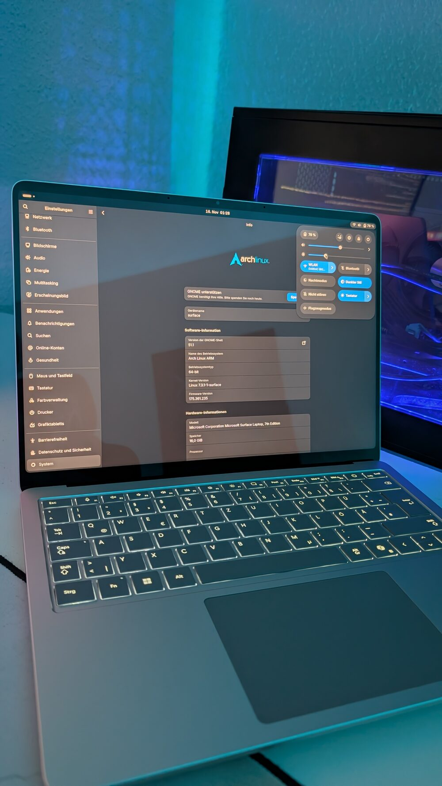
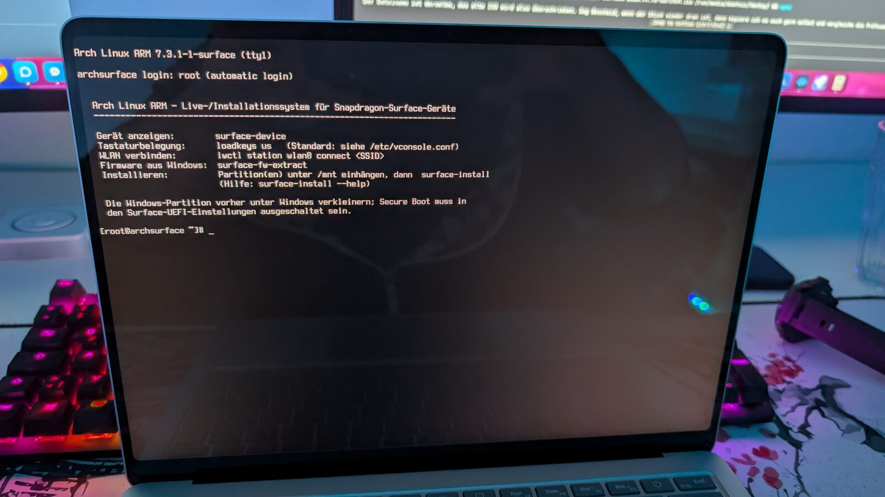
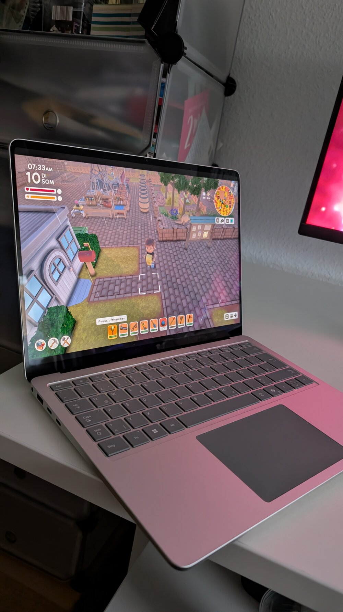

# Arch Linux ARM64 für Snapdragon-Surface-Geräte

[English](README.md) | **Deutsch**

> ## ⬇️ Download
>
> **[Fertiges ISO herunterladen](https://drive.3dns.eu/dl/131617b07bbc33190decce1ac3b562aa?path=archlinux)**
> (rund 0,8 GB)
>
> Auf einen [Ventoy](https://github.com/ventoy/Ventoy)-Stick kopieren oder
> mit `dd` auf einen USB-Stick schreiben, dann weiter bei
> [Starten](#starten). Das ISO lässt sich auch mit einem Befehl
> [selbst bauen](#bauen).

<p align="center">
  
  &nbsp;
  
</p>
<p align="center"><em>Surface Laptop 7 (13,8"): das installierte System mit GNOME und das Live-System direkt nach dem Start vom ISO</em></p>

Baut ein bootfähiges Live-/Installations-ISO (aarch64, UEFI) mit

- **Userland** aus dem [aarch64-Port von Arch Linux](https://ports.archlinux.page/aarch64/)
  (noch kein offizieller Port; wahlweise aus
  [Arch Linux ARM](https://archlinuxarm.org), siehe [Userland](#userland)),
- **Kernel** `linux-surface` aus dem aarch64-Paket-Repository von
  [linux-surface](https://github.com/linux-surface) (enthält die Devicetrees
  und Treiber für die Snapdragon-Surfaces),
- **Firmware** aus `linux-firmware` (Qualcomm, Atheros, …), der Pro-X-Firmware
  von linux-surface sowie einem Werkzeug, das die gerätespezifische Firmware
  aus der Windows-Installation des Geräts übernimmt,
- einem **GRUB-Bootmenü**, das für jedes Gerät den passenden Devicetree lädt,
- einem **Installer** (`surface-install`), der das System samt Bootloader und
  Devicetree auf die interne SSD bringt.

## Unterstützte Geräte

| ID          | Gerät                               | SoC       | Devicetree                           |
|-------------|-------------------------------------|-----------|--------------------------------------|
| `spx`       | Surface Pro X (SQ1/SQ2)             | SC8180X   | `sc8180x-surface-pro-x.dtb`          |
| `sp9-5g`    | Surface Pro 9 5G (SQ3)              | SC8280XP  | `sc8280xp-microsoft-arcata.dtb`      |
| `devkit`    | Windows Dev Kit 2023                | SC8280XP  | `sc8280xp-microsoft-blackrock.dtb`   |
| `sl7-13`    | Surface Laptop 7 13,8"              | X1E80100  | `x1e80100-microsoft-romulus13.dtb`   |
| `sl7-15`    | Surface Laptop 7 15"                | X1E80100  | `x1e80100-microsoft-romulus15.dtb`   |
| `sp11-lcd`  | Surface Pro 11 (LCD, X Plus)        | X1P64100  | `x1p64100-microsoft-denali.dtb`      |
| `sp11-oled` | Surface Pro 11 (OLED, X Elite)      | X1E80100  | `x1e80100-microsoft-denali-oled.dtb` |
| `sp12`      | Surface Pro 12" (2025, X Plus)      | X1P42100  | `x1p42100-microsoft-sp12in.dtb`      |

Die Liste steht in [`devices.conf`](devices.conf) und entspricht den
Devicetrees, die der linux-surface-Kernel mitbringt.

### Hardware-Unterstützung

Die Tabelle zeigt, welche Hardware der linux-surface-Kernel (7.3.1) im
Devicetree des jeweiligen Geräts beschreibt. Bis auf die Spalte Surface
Laptop 7 13,8" ist sie aus den Kernel-Quellen abgelesen und **nicht auf
Hardware getestet**: „✓“ heißt „Treiber ist vorgesehen“, nicht „funktioniert
garantiert“. Den tatsächlichen Stand zeigen das Wiki und die Issues von
linux-surface.

| Funktion | Pro X (SQ1/SQ2) | Pro 9 5G | Dev Kit 2023 | Laptop 7 (13,8"/15") | Pro 11 (LCD/OLED) | Pro 12" |
|---|---|---|---|---|---|---|
| Internes Display | ✓ | ✓ | – (kein Display) | ✓ | ✓ | ✓ |
| GPU-Beschleunigung | ✓ (FW) | ✓ (FW) | ✓ (FW) | ✓ (FW) | ✓ (FW) | ✓ (FW) |
| Interner Speicher | ✓ NVMe | ✓ NVMe | ✓ NVMe | ✓ NVMe | ✓ NVMe | ✓ UFS |
| USB-C / USB | ✓ | ✓ | ✓ | ✓ | ✓ | ✓ |
| Externer Monitor über USB-C | – | ✓ | ✓ | ✓ | ✓ | ✓ |
| Ton über DisplayPort | – | – | – | ✓ (15", Overlay) | – | – |
| WLAN | ✓ (WCN3990) | ✓ (WCN6855) | ✓ (WCN6855) | ✓ (WCN7850, gepatchtes Modul) | ✓ (WCN7850) | ✓ (WCN7850) |
| Bluetooth | ✓ | ✓ | ✓ | ✓ | ✓ | ✓ |
| Ton | – | ✓ (FW) | ✓ (FW) | ✓ (FW) | ✓ (FW) | ✓ (FW) |
| Tastatur, Akku (Surface Aggregator) | ✓ | ✓ | – (USB-Geräte) | ✓ | ✓ | ✓ |
| Touchpad | ? | ? | – | ✓ (Zusatzmodule + iptsd) | ? | ? |
| Touchscreen | – | – | – | ✓ (Zusatzmodule + iptsd) | – | ✓ |
| Kameras | – | – | – | ✓ Frontkamera (Overlay + libcamera) | – | – |
| Videocodec (Hardware, H.264/H.265) | – | – | – | ✓ (FW, Overlay) | – | – |
| Mobilfunk (LTE/5G) | – | – | – | – | – | – |

- **✓**: im Devicetree beschrieben, Treiber im Kernel vorhanden.
- **(FW)**: braucht zusätzlich die signierte Firmware aus Windows
  (`surface-fw-extract`, siehe unten). Beim Pro X ist sie schon im ISO.
- **–**: im Devicetree nicht beschrieben, also nach aktuellem Stand ohne
  Funktion.

**Getestet auf einem Surface Laptop 7 13,8"** (X Plus, Modell 2036, eigener
Kernel 7.3.1-1.1): Start über Ventoy, Installation, Display samt Helligkeit,
GPU-Beschleunigung (freedreno, Adreno X1-85, OpenGL 4.6 und Vulkan über
Turnip), Tastatur samt
Beleuchtung, Touchpad, Touchscreen, Frontkamera, NVMe, USB, WLAN, Bluetooth,
Ton, Akkuanzeige und GNOME funktionieren; der Start dauert etwa 5 s. Standby
und Aufwachen funktionieren (getestet mit 17 Stunden Schlaf): Touchpad
und Touchscreen sind im Standby stromlos und reagieren etwa 3 s nach dem
Aufklappen wieder. Im Standby verliert der Akku etwa 1 % pro Stunde (rund
0,5 W): Nur die CPU-Kerne schlafen, den tiefsten Schlafzustand des SoC
(`cxsd`) erreicht der Kernel noch nicht. Einen Ruhezustand gibt es nicht. Bei der
10-Kern-Variante (X Plus) beschreibt der Devicetree 12 Kerne; das Live-System
meldet deshalb `CPU7`/`CPU11 failed to boot` (harmlos). `surface-install`
erkennt die fehlenden Kerne und trägt sie als `SURFACE_DTB_CPUS_ABSENT` ein;
`surface-dtb-update` entfernt sie dann samt Topologie-Eintrag und
Energiedomäne aus dem Devicetree des installierten Systems. Ein bloßes
`status = "fail"` reichte nicht: Ihre Energiedomänen blieben wegen
`pd_ignore_unused` an, und die Cluster kämen nie in den Tiefschlaf.

**CPU-Takt:** Für die CPU-Cluster 2 und 3 (Kerne 4–11) meldet die Firmware
keine Dauerfrequenz, also wäre jede Taktstufe ein Turbo, und Linux verwürfe
sie beim Einrichten von cpufreq allesamt. Diese Kerne ließen sich dann nicht
heruntertakten, das kostet Akku. Der eigene Kernel (siehe unten) behandelt
diesen Fall: Alle drei Cluster takten mit 0,7–3,4 GHz
([Patch](kernel/0002-arm_scmi-perf-no-turbo-without-sustained-freq.patch)).
Mit dem unveränderten linux-surface-Kernel bleibt nur Cluster 1 regelbar. Das
ISO stellt den Taktregler `schedutil` ein; mit der Voreinstellung des Kernels
(`performance`) liefen alle Kerne dauernd mit 3,4 GHz.

**Spiele:** Windows-Spiele für x86-64 laufen mit
[Box64](https://github.com/ptitSeb/box64) und Proton; die Grafik rechnet die
Adreno-GPU über Vulkan (Turnip). Getestet mit Dinkum.

<p align="center">
  
</p>
<p align="center"><em>Dinkum auf dem Surface Laptop 7, über Box64 und Proton</em></p>

Der Surface Laptop 7 braucht einige Dinge, die der linux-surface-Kernel noch
nicht mitbringt; ISO und `surface-install` richten sie automatisch ein:

- **WLAN:** Der rfkill-Eingang des WCN7850 meldet dauerhaft „Funk aus“, ath12k
  sperrt das WLAN dann hart. Ein gepatchtes `ath12k`-Modul
  ([Patch](airootfs/usr/share/surface/patches/ath12k-sl7-rfkill.patch))
  überspringt diese Abfrage.
- **Touchpad und Touchscreen:** Beide sind HID-over-SPI-Geräte an QSPI-Bussen.
  Dem Kernel fehlen der QSPI-Modus von `spi-geni-qcom`, das QSPI-Protokoll des
  GPI-DMA-Treibers und ein passender `spi-hid`; sie stammen aus dem
  ELLX-Kernel
  ([Quellen](airootfs/usr/share/surface/kmods/sl7-touchpad)). Die
  Devicetree-Einträge werden als Overlays ergänzt
  ([Touchpad](airootfs/usr/share/surface/overlays/sl7-touchpad.dtso),
  [Touchscreen](airootfs/usr/share/surface/overlays/sl7-touchscreen.dtso)),
  und `iptsd` macht aus den Rohdaten Eingabeereignisse. iptsd kommt aus dem
  [Paket-Repository von Omarchy](https://github.com/omacom/omarchy-pkgs)
  (mit deren Patch, der das Drücken des drucksensitiven Touchpads zum Klick
  macht); ISO und installiertes System binden es als letztes Repository ein,
  es kann also keine Pakete des Userlands ersetzen, und `pacman -Syu`
  hält iptsd aktuell und gegen neue Bibliotheken gebaut.
- **Bluetooth:** Der Controller hat unter Linux keine Adresse und taucht in
  BlueZ nicht auf; `surface-bt-addr` vergibt beim Start eine feste.
- **WLAN-Land:** Ohne Regulierungsdomäne braucht das Verbinden nach dem Start
  und nach jedem Aufwachen 20–30 s länger. `surface-wifi-country` setzt das
  Land aus `/etc/conf.d/wireless-regdom`; bei deutscher Sprache trägt
  `surface-install` dort `DE` ein, sonst bitte selbst einstellen.
- **Frontkamera:** Im Devicetree fehlen das Kamera-Subsystem (CAMSS) und die
  CCI-Busse. Ein Overlay ergänzt sie samt Sensor OV02C10
  ([Quelle](overlays-src/sl7-camera.dts.in), nach Patches von Omarchy); die
  Treiber sind bereits im Kernel. Programme nutzen sie über den Software-ISP
  von libcamera, z. B. per PipeWire in Browsern und Videotelefonie.
  `surface-install` legt dazu eine udev-Regel an, damit der angemeldete
  Benutzer den System-dma-buf-Heap nutzen darf, den der Software-ISP braucht
  (bewusst nicht den kleinen CMA-Heap, den libcamera sonst bevorzugt und
  schnell erschöpft), und
  eine WirePlumber-Regel, die die rohen CAMSS-Videoknoten ausblendet; so
  sehen Programme eine Kamera statt sechzehn. libcamera 0.7.2 kennt den
  Sensor nicht und schätzt den Schwarzwert sonst aus jedem Bild; im Dunkeln
  werden dann Schatten rot und helle Flächen cyan. Eine Abstimmungsdatei
  ([`ov02c10.yaml`](airootfs/usr/share/surface/target/etc/libcamera/ipa/simple/ov02c10.yaml),
  unter `/etc/libcamera/ipa/simple/`) setzt den festen Schwarzwert 0x40
  (10 Bit; am Gerät bei minimaler Belichtung gemessen: 64,06). Bei
  Raumlicht sind die Farben damit stimmig, wenn auch etwas blass (ohne
  eingemessene Farbmatrix). In sehr dunklen Räumen bleibt ein Cyanstich: Der
  Weißabgleich des Software-ISP verstärkt Rot höchstens vierfach, und die
  Belichtung regelt langsam nach. Von Hand einstellen lassen sich Kontrast,
  Gamma und Sättigung mit `surface-camera` (z. B. `surface-camera gamma 3`
  hellt dunkle Räume auf); die Werte gelten für alle Programme, die die Kamera
  über PipeWire nutzen, und werden beim Anmelden wieder gesetzt. Werkzeuge für
  USB-Webcams wie cameractrls finden diese Kamera nicht: Sie ist ein reiner
  Bildsensor, die Bildverarbeitung macht libcamera. Belichtung und
  Weißabgleich regelt libcamera 0.7 nur automatisch. Die IR-Kamera (Windows
  Hello) ist nicht beschrieben.
- **Videocodec:** Der Hardware-Codec des Snapdragon (Iris, V4L2-Decoder und
  -Encoder für H.264/H.265) ist im SoC-Devicetree beschrieben, aber
  abgeschaltet, weil seine Firmware vom Gerätehersteller signiert ist. Ein
  Overlay schaltet ihn ein und nennt die Firmware
  ([Overlay](airootfs/usr/share/surface/overlays/sl7-video.dtso));
  `surface-fw-extract` holt `qcvss8380.mbn` wie die übrige Firmware aus
  Windows. Der eigene Kernel bringt dafür ab 7.3.1-1.4 den Treiber
  (`CONFIG_VIDEO_QCOM_IRIS`) und die Videotakte (`CONFIG_SM_VIDEOCC_8550`)
  mit; im unveränderten linux-surface fehlen beide. Mit dem Videotakt-Treiber
  sind alle Verbraucher der Versorgungsschienen bekannt, und der Kernel senkt
  ungenutzte Schienen ab. Dem GPU-Takt-Controller fehlten im Devicetree die
  Schienen MX und CX – die GPU fiel dann bei manchen Starts aus (`hangcheck
  detected gpu lockup`); ein
  [Patch](kernel/0003-arm64-dts-qcom-hamoa-gpucc-power-domains.patch) trägt
  sie für alle X1E/X1P-Geräte nach.
- **Ton über DisplayPort:** Der Sound-Knoten von Romulus deklariert keine
  DAI-Links für Display-Audio, deshalb legt die Karte kein DP-PCM an und der
  Tonausgang des Monitors bleibt stumm. Ein Overlay ergänzt die beiden Links
  für `mdss_dp0`/`mdss_dp1` und deren `#sound-dai-cells`
  ([Overlay](airootfs/usr/share/surface/overlays/sl7-dpaudio.dtso)); der
  Machinentreiber behandelt `DISPLAY_PORT_RX`-Jacks bereits, und das
  ALSA-UCM-Profil bringt das PCM mit, mehr ist dafür nicht nötig. Getestet
  auf dem 15" über USB-C DisplayPort; das 13,8" ist ungetestet und bekommt
  das Overlay noch nicht.
- **Tastaturbeleuchtung:** Die Beleuchtungstaste funktioniert von sich aus
  (die Firmware schaltet ihre Stufen selbst weiter). Ein kleiner HID-Treiber
  stellt sie zusätzlich als `/sys/class/leds/surface::kbd_backlight` bereit
  (Stufen 0–12), damit der Desktop sie anzeigen und einstellen kann
  ([Quelle](airootfs/usr/share/surface/kmods/sl7-kbd-backlight)).

**Eigener Kernel:** ISO und installierte Systeme beziehen `linux-surface` aus
einem eigenen Repository (`[surface-kernel]` in der Gitea-Paketregistry dieses
Projekts, in `pacman.conf` vor `[linux-surface]`). Der Kernel entspricht
linux-surface (gleicher Quellstand, gleiche Konfiguration) und enthält
zusätzlich die Treiber oben (WLAN-Patch, Touchpad/Touchscreen,
Tastaturbeleuchtung, Videocodec) sowie einen Fix für den CPU-Takt (siehe oben)
([PKGBUILD](kernel/PKGBUILD)). Die Version `7.3.1-1.1` steht für
linux-surface `7.3.1-1` plus eigene Revision `.1`. Gebaut wird er mit
`scripts/build-kernel.sh` per Cross-Compiler in Docker (etwa 20 Minuten auf
16 Kernen). Für jede neue linux-surface-Version muss er neu gebaut werden,
bis dahin bleiben installierte Systeme auf dem bisherigen Kernel. Das geht auf
Knopfdruck mit dem Gitea-Workflow „Kernel bauen“ (siehe [CI](#ci)) oder
lokal:

```sh
scripts/build-kernel.sh --latest upload   # neueste linux-surface-Version bauen und hochladen
scripts/build-kernel.sh --tag linux_surface-7.3.1-1 --force upload   # neue Revision derselben Version
```

`--latest`/`--tag` übernehmen Quellstand und Konfiguration aus dem PKGBUILD
von linux-surface ([`scripts/kernel-update.py`](scripts/kernel-update.py));
liegt die Version schon in der Registry, wird ohne `--force` nichts gebaut.

Ohne den eigenen Kernel (`WITH_SURFACE_KERNEL=0`) kommen die Treiber als
Zusatzmodule: `surface-kmods` baut sie nach
`/usr/lib/modules/<Kernel>/updates/`, und ein pacman-Hook baut sie und den
Devicetree nach Kernel-Updates neu (`surface-kernel-update`; braucht dann
Netzzugang, weil die passenden Kernel-Quellen geholt werden). Für den eigenen
Kernel baut `surface-kmods` nichts. Welche Overlays und Module ein Gerät
bekommt, steht in [`overlays.conf`](overlays.conf).

Beim 15"-Modell werden dieselben Overlays angewendet; sie folgen dessen
ACPI-Tabellen und den Patches anderer Projekte, sind hier aber nicht getestet.

„?“ beim Touchpad heißt: nicht geprüft. Stift und Fingerabdruckleser/Windows
Hello sind nicht einzeln geprüft. Beim
Pro X läuft das WLAN nur mit den Zusatzdiensten `tqftpserv` und `rmtfs`; sie
sind im ISO enthalten und werden vom Installer mit eingerichtet.

## Bauen

Voraussetzung ist nur **Docker**. Auf einem x86_64-Host wird das aarch64-System
per Emulation (`binfmt_misc` + qemu-user) erzeugt; fehlt die Registrierung,
richtet `build.sh` sie über das Image `tonistiigi/binfmt` ein (gilt bis zum
nächsten Neustart des Hosts).

```sh
./build.sh            # ISO bauen -> out/archlinux-arm64-surface-<Datum>-aarch64.iso
./build.sh clean      # Zwischenstände (Docker-Volumes) löschen
./build.sh shell      # Shell im Build-Container
```

Einstellungen stehen in [`config.sh`](config.sh) und lassen sich per Umgebung
überschreiben, z. B. `LIVE_LANG=en LIVE_KEYMAP=us ./build.sh`. Die Pakete des Live-Systems
stehen in [`packages.txt`](packages.txt).

Rauchtest in QEMU (ohne Surface-Hardware, generischer Booteintrag):

```sh
scripts/test-qemu.sh          # serielle Konsole, beenden mit Strg+A, X
```

### Userland

Die Pakete kommen standardmäßig aus den Community-Repositories des
[aarch64-Ports von Arch Linux](https://ports.archlinux.page/aarch64/)
(`forge`, `core`, `extra` unter `arch-linux-repo.drzee.net`, gebaut für ARMv8.2
und neuer). Sie folgen Arch Linux eng und führen fast alle seiner Pakete. Der
Port ist noch nicht offiziell: Die Pakete werden weder auf der Infrastruktur
von Arch Linux gebaut noch von dessen Team signiert, sondern vom Betreiber
dieses Repositorys. Der Build legt den Signaturschlüssel über seinen
Fingerabdruck fest (`PORT_KEY_FPR` in `config.sh`).

`USERLAND=alarm ./build.sh` baut stattdessen mit
[Arch Linux ARM](https://archlinuxarm.org).

**Firmware:** Arch Linux liefert `linux-firmware` zstd-komprimiert (`*.zst`),
der linux-surface-Kernel kann aber nur xz-komprimierte Firmware laden. Ohne
Umwandlung fehlen WLAN, Bluetooth, GPU-Beschleunigung und Ton.
`surface-firmware-xz` legt deshalb neben jede `*.zst`-Datei unter
`/usr/lib/firmware` eine `*.xz`-Datei; der pacman-Hook
`85-surface-firmware.hook` wiederholt das nach jedem Firmware-Update, bevor
das Initramfs neu gebaut wird. ISO und installiertes System bringen beides
mit. Das kostet etwa noch einmal so viel Plattenplatz wie die Firmware selbst.
Der Kernel aus diesem Repository (`surface-kernel`, ab 7.3.1-1.2) lädt zstd
selbst (`CONFIG_FW_LOADER_COMPRESS_ZSTD`); sobald alle installierten Kernel und
der laufende das können, entfernt das Skript die xz-Kopien wieder.

Ein installiertes System behält das Userland, mit dem es installiert wurde. Um
eines von Arch Linux ARM auf den Port umzustellen: den Schlüssel aus dem Paket
`archports-keyring` aufnehmen (Fingerabdruck prüfen), in `/etc/pacman.conf`
`[core]`, `[extra]`, `[alarm]` und `[aur]` durch `[forge]`, `[core]` und
`[extra]` des Ports ersetzen, `/var/cache/pacman/pkg` leeren (die Paketdateien
heißen gleich, sind aber anders signiert) und alle Pakete neu installieren, die
der Port führt (`pacman -Qqn`). Arch Linux ARM teilt die GCC-Laufzeit in
`libgcc`, `libstdc++` usw. auf, der Port liefert sie als ein `gcc-libs`: deren
Dateien mit `--overwrite` übergeben, danach die Einzelpakete mit
`pacman -Rdd --dbonly` entfernen. Vor dem Neustart `surface-firmware-xz` und
den zugehörigen Hook (siehe oben) aus diesem Repository installieren, einmal
ausführen und das Initramfs neu bauen (`mkinitcpio -P`), sonst startet das
System ohne WLAN. Zurück geht es nur auf demselben Weg in umgekehrter
Richtung.

## Auf den USB-Stick bringen

### Ventoy

Die ISO-Datei einfach auf den Ventoy-Stick kopieren und im Ventoy-Menü
auswählen („Boot in normal mode“). Das Live-System sucht die ISO-Datei beim
Start selbst auf dem Stick (Initramfs-Hook `surface_isoscan`, Dateisysteme
exFAT/NTFS/FAT/ext4, bis drei Verzeichnisebenen tief) und bindet sie per
Loop-Mount ein. Alternativ funktioniert Ventoys „GRUB2 mode“ über die
mitgelieferte `boot/grub/loopback.cfg`.

Ventoy muss dafür selbst auf dem Gerät starten können (ARM64-UEFI, Secure Boot
aus). Falls nicht: das ISO direkt auf einen Stick schreiben.

### Direkt schreiben (dd)

```sh
sudo dd if=out/archlinux-arm64-surface-<Datum>-aarch64.iso of=/dev/sdX bs=4M conv=fsync status=progress
```

(`/dev/sdX` = der Stick, **nicht** eine Partition. Alle Daten darauf gehen
verloren.)

## Starten

1. Unter Windows: BitLocker/Geräteverschlüsselung ggf. abschalten oder den
   Wiederherstellungsschlüssel bereithalten, „Schnellstart“ deaktivieren und
   die Windows-Partition verkleinern, um Platz für Linux zu schaffen.
2. Surface-UEFI öffnen (Gerät aus, **Lauter** gedrückt halten, Power drücken):
   - *Security → Secure Boot*: **ausschalten**,
   - *Boot configuration*: USB-Start erlauben und nach oben schieben.
3. Vom Stick starten (Gerät aus, **Leiser** gedrückt halten, Power drücken).
4. Im Bootmenü das Gerät wählen. Wird das Gerät über die Firmware-Angaben
   erkannt, ist der passende Eintrag vorausgewählt; diese Erkennung ist nur
   eine Hilfe – ein falscher Devicetree startet nicht oder ohne Bild.

Die ersten beiden Einträge des Bootmenüs stellen **Sprache** (Deutsch/Englisch)
und **Tastaturbelegung** um. Beides gilt für das Live-System und wird von
`surface-install` ins installierte System übernommen. Später ändern:

```sh
surface-locale --lang en --keymap us   # oder: --lang de --keymap de-latin1
surface-locale --list-keymaps
```

Welche Belegungen das Bootmenü anbietet, steht in
[`keymaps.conf`](keymaps.conf); die Vorgaben sind `LIVE_LANG` und `LIVE_KEYMAP`
in `config.sh`.

Das Live-System meldet sich automatisch als `root` an.

## Installieren

```sh
surface-device                      # erkanntes Gerät anzeigen
iwctl station wlan0 connect <SSID>  # WLAN (oder USB-Ethernet/-Tethering)

# Partitionieren und formatieren (Beispiel: freier Platz hinter Windows)
cfdisk /dev/nvme0n1
mkfs.ext4 /dev/nvme0n1pN

mount /dev/nvme0n1pN /mnt
mount --mkdir /dev/nvme0n1p1 /mnt/efi   # vorhandene EFI-Systempartition

surface-install /mnt
```

`surface-install`

- installiert `base`, `linux-surface`, `linux-firmware`, GRUB u. a. per `pacstrap`,
- trägt das linux-surface-Repository in `/etc/pacman.conf` ein (Kernel-Updates
  kommen danach ganz normal über `pacman -Syu`),
- richtet ein Initramfs mit allen nötigen Plattformtreibern ein
  (Hook `surface-qcom`, eingetragen in `/etc/mkinitcpio.conf`),
- übernimmt die gerätespezifische Firmware aus Windows (`surface-fw-extract`),
- installiert GRUB und erzeugt über `/etc/grub.d/09_surface` einen Eintrag mit
  dem Devicetree des Geräts (`/etc/default/surface-boot`). `grub-mkconfig`
  funktioniert danach wie gewohnt,
- richtet zram (komprimierter Swap im RAM, halbe RAM-Größe, höchstens 8 GB) und
  systemd-oomd ein: Bei Speichermangel wird so nicht mehr das ganze System
  zäh und friert ein, sondern oomd beendet bei anhaltendem Druck das
  verursachende Programm.

Partitionieren, Formatieren und Einhängen macht das Skript bewusst nicht
selbst.

### Firmware

Die DSP- und GPU-Firmware der Geräte ist von Microsoft/Qualcomm signiert und
nicht frei verteilbar. `surface-fw-extract` liest aus dem Devicetree, welche
Dateien der Kernel erwartet, sucht sie im Treiberspeicher der
Windows-Installation (BitLocker-Partitionen werden mit dem
Wiederherstellungsschlüssel über `cryptsetup` geöffnet) und legt sie unter
`/usr/lib/firmware` ab:

```sh
surface-fw-extract --list           # was wird gebraucht, was fehlt?
surface-fw-extract --root /mnt      # ins Live- und ins installierte System
```

Ohne diese Dateien startet das System trotzdem, es fehlen dann aber z. B.
GPU-Beschleunigung, Ton und Akkuanzeige.

Für das **Surface Pro X** ist die Firmware aus
[linux-surface/aarch64-firmware](https://github.com/linux-surface/aarch64-firmware)
bereits im ISO enthalten (`WITH_SPX_FIRMWARE=1`). Dafür gibt es keine
ausdrückliche Weitergabe-Lizenz – das ISO deshalb nicht öffentlich verteilen
oder mit `WITH_SPX_FIRMWARE=0` bauen.

### Secure Boot

Das installierte System lässt sich mit Secure Boot und eigenen Schlüsseln
betreiben; Windows startet weiter, weil die Schlüssel von Microsoft mit
eingetragen werden. Unter Secure Boot sperrt GRUB den Befehl `devicetree`,
ohne den diese Geräte nicht starten. Deshalb startet das System dann über
**systemd-boot** und ein signiertes **UKI**, das Kernel, Initramfs, Devicetree
und Kernel-Parameter in einer EFI-Datei vereint
([`surface-uki`](airootfs/usr/local/bin/surface-uki)). Zwei Schritte mit
Neustart dazwischen ([`surface-secureboot`](airootfs/usr/local/bin/surface-secureboot)):

```sh
surface-secureboot boot     # systemd-boot + UKI einrichten (Secure Boot noch aus), neu starten
# Surface-UEFI (Lauter-Taste + Ein/Aus) → Sicherheit → Secure Boot "None" (Setup Mode)
surface-secureboot enroll   # eigene + Microsoft-Schlüssel eintragen, signieren, neu starten
surface-secureboot status
```

`enroll` bricht ab, wenn die Zertifikate von Microsoft nicht die CA enthalten,
mit der Windows signiert ist (beim Laptop 7: „Windows UEFI CA 2023“).
Kernel-Updates bauen und signieren das UKI automatisch neu (pacman-Hook,
mkinitcpio). GRUB bleibt als Eintrag im Menü von systemd-boot, startet aber
nur ohne Secure Boot. Startet etwas nicht: im Surface-UEFI Secure Boot auf
„None“ stellen. Das ISO startet nicht mit Secure Boot; zum Installieren also
vorübergehend ausschalten.

**Experimentell:** Auf dem Laptop 7 (13,8") startete Linux mit Secure Boot,
nach einem Start von Windows aber nicht mehr – die Firmware startete nur noch
Windows, bis Secure Boot wieder auf „None“ stand. Vermutlich ändert Windows
beim Start die Secure-Boot-Datenbank (Umstellung auf die Microsoft-Zertifikate
von 2023); die Ursache ist noch nicht geklärt. Wer Windows parallel nutzt,
lässt Secure Boot vorerst aus.

## Aufbau

```
build.sh                      Einstieg auf dem Host (Docker, binfmt)
config.sh                     Einstellungen
devices.conf                  Geräte, Devicetrees, Kernel-Parameter
overlays.conf                 Devicetree-Overlays und Zusatzmodule je Gerät
keymaps.conf                  Tastaturbelegungen im Bootmenü
packages.txt                  Pakete des Live-Systems
scripts/build-in-container.sh eigentlicher Build (pacstrap, SquashFS, GRUB, xorriso)
scripts/chroot-customize.sh   Anpassungen im aarch64-Root (Initramfs, GRUB-Image)
scripts/test-qemu.sh          Rauchtest in QEMU
scripts/build-kernel.sh       eigenen Kernel bauen (Cross-Compile in Docker) und hochladen
kernel/                       PKGBUILD und Patches des eigenen Kernels
airootfs-pre/                 Dateien, die vor der Paketinstallation ins Root kommen
                              (Initramfs-Hooks surface-qcom und surface_isoscan)
airootfs/                     Overlay des Live-Systems (Werkzeuge, systemd-Units)
overlays-src/                 Overlay-Quellen, die die dt-bindings-Header des Kernels brauchen;
                              scripts/gen-overlays.sh erzeugt daraus die .dtso-Dateien
```

Das ISO ist ein Hybrid-Image (ISO9660 + GPT mit FAT-EFI-Systempartition).
Kernel, Initramfs, Devicetrees und GRUB liegen in der EFI-Partition, das
Root-Dateisystem als SquashFS (`arch/aarch64/airootfs.sfs`, xz – zstd kann der
linux-surface-Kernel in SquashFS nicht lesen) im ISO; das Initramfs nutzt die
Hooks aus `mkinitcpio-archiso`.

## CI

[`.gitea/workflows/build-iso.yml`](.gitea/workflows/build-iso.yml) baut das
ISO auf einem Gitea-Actions-Runner (von Hand oder bei einem Tag `v*`), lädt es
als Artefakt hoch und hängt es an das Release des Tags. Der Runner muss dem
Job erlauben, privilegierte Docker-Container zu starten. Der Workflow baut
ohne die Pro-X-Firmware (`WITH_SPX_FIRMWARE=0`), weil sie nicht weitergegeben
werden darf. Das ISO ist rund 0,8 GB groß; der Build braucht etwa 10 GB Platz
und beim ersten Lauf 45–60 Minuten.

[`.gitea/workflows/build-kernel.yml`](.gitea/workflows/build-kernel.yml)
(„Kernel bauen“, nur von Hand) bringt den eigenen Kernel auf die neueste
linux-surface-Version (oder einen gewählten Tag), baut ihn, lädt ihn in die
Paketregistry und checkt das aktualisierte PKGBUILD ein. Er braucht das Secret
`KERNEL_TOKEN` (Gitea-Token mit Schreibrecht auf Pakete und Repository) und
einen x86_64-Runner mit Docker; der Bau dauert etwa 20 Minuten auf 16 Kernen.

## Bekannte Grenzen

- Der Build wurde in QEMU getestet (generischer UEFI/ACPI-Start, direkt als
  USB-Datenträger und über Ventoy), **nicht auf echter Surface-Hardware**.
  Devicetrees und Kernel-Parameter folgen den Quellen von linux-surface. Auf
  echter Hardware lief bisher nur der Surface Laptop 7 13,8" (siehe
  „Hardware-Unterstützung“); für die anderen Geräte ist die Erkennung im
  Bootmenü (SMBIOS-Namen) eine Annahme.
- Auf den X-Elite/X-Plus-Geräten hängt die USB-C-Steckerorientierung teils an
  Firmware, die erst nach `surface-fw-extract` vorhanden ist. Wird der Stick
  beim Start nicht gefunden: Stecker drehen oder einen anderen Anschluss
  (USB-A, falls vorhanden) verwenden.
- Surface Pro 11 (LCD/OLED) lässt sich über die Firmware-Angaben nicht sicher
  unterscheiden und muss im Bootmenü von Hand gewählt werden.
- Surface Pro X: Sollte das Standard-GRUB nicht starten, liegt das gepatchte
  GRUB von linux-surface unter `EFI/spx/bootaa64.efi` in der EFI-Partition des
  Sticks (Menüeintrag oder nach `EFI/BOOT/BOOTAA64.EFI` kopieren).
- UEFI-Variablen sind unter Linux nicht auf allen Geräten schreibbar. Dann
  kann `surface-install` GRUB auf Nachfrage als Standard-Bootloader
  (`EFI/BOOT/BOOTAA64.EFI`, mit Sicherung der vorhandenen Datei) ablegen.

## Referenzen

Kernel

- [linux-surface/kernel](https://github.com/linux-surface/kernel) –
  Kernelquellen mit den Surface-Patches und Devicetrees
- [linux-surface/aarch64-packages](https://github.com/linux-surface/aarch64-packages)
  – Arch-Paketierung von `linux-surface` für aarch64 (von dort stammen auch
  die hier verwendeten PKGBUILDs für `qrtr`, `tqftpserv`, `rmtfs-dummy`)
- [linux-surface/repo](https://github.com/linux-surface/repo) –
  Paket-Repository (`https://pkg.surfacelinux.com/arch-aarch64/`)

Firmware

- [linux-surface/aarch64-firmware](https://github.com/linux-surface/aarch64-firmware)
  – Firmware für das Surface Pro X
- [linux-firmware](https://git.kernel.org/pub/scm/linux/kernel/git/firmware/linux-firmware.git)
  – Upstream-Firmware (Qualcomm, Atheros, …)
- [linux-msm](https://github.com/linux-msm) – Qualcomm-Userspace (`qrtr`,
  `tqftpserv`, `rmtfs`)

Weitere Bausteine

- [linux-surface](https://github.com/linux-surface) – das Projekt insgesamt,
  Wiki und Issues
- [linux-surface/aarch64-arch-mkimg](https://github.com/linux-surface/aarch64-arch-mkimg)
  – die Image-Skripte von linux-surface für das Pro X (Vorbild für dieses
  Projekt)
- [linux-surface/grub-image-aarch64](https://github.com/linux-surface/grub-image-aarch64)
  – gepatchtes GRUB für das Pro X
- [Arch Linux Ports – aarch64](https://ports.archlinux.page/aarch64/)
- [Arch Linux ARM](https://archlinuxarm.org) und dessen
  [PKGBUILDs](https://github.com/archlinuxarm/PKGBUILDs)
- [archiso](https://gitlab.archlinux.org/archlinux/archiso) /
  [mkinitcpio-archiso](https://gitlab.archlinux.org/archlinux/mkinitcpio/mkinitcpio-archiso)
- [Ventoy](https://github.com/ventoy/Ventoy)

## Kontakt

Fragen, Testberichte von anderen Geräten oder Korrekturen sind willkommen:

- Webseite: <https://dom1nic.eu/about>
- Matrix: [@dom1nic:3dns.eu](https://matrix.to/#/@dom1nic:3dns.eu)
