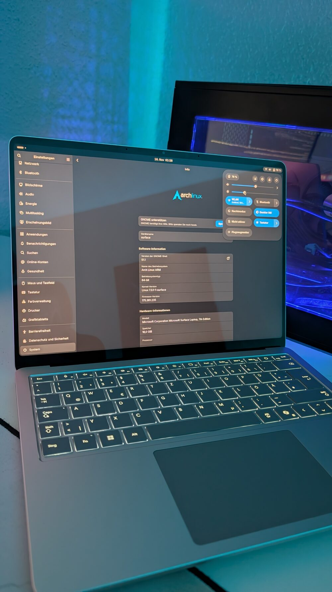
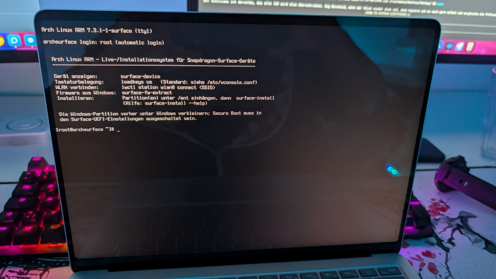
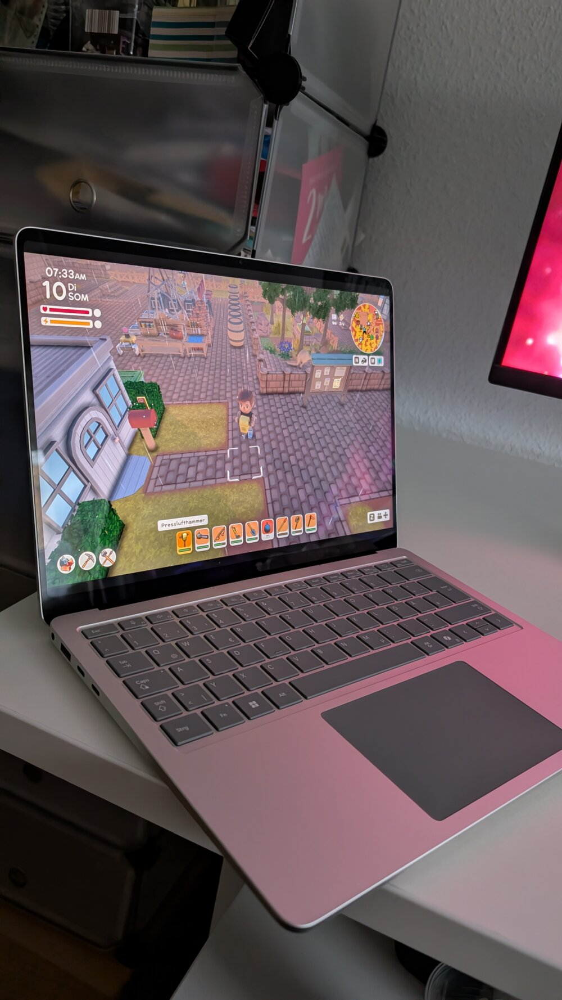

# Arch Linux ARM64 for Snapdragon-based Surface devices

**English** | [Deutsch](README.de.md)

> ## ⬇️ Download
>
> **[Download the ready-made ISO](https://drive.3dns.eu/dl/131617b07bbc33190decce1ac3b562aa?path=archlinux)**
> (about 0.8 GB)
>
> Copy it onto a [Ventoy](https://github.com/ventoy/Ventoy) drive or write it
> to a USB drive with `dd`, then continue with [Booting](#booting). You can
> also [build the ISO yourself](#building) with a single command.

<p align="center">
  
  &nbsp;
  
</p>
<p align="center"><em>Surface Laptop 7 (13.8"): the installed system with GNOME, and the live system right after booting the ISO</em></p>

Builds a bootable live/installation ISO (aarch64, UEFI) with

- **userland** from the [aarch64 port of Arch Linux](https://ports.archlinux.page/aarch64/)
  (not an official port yet; alternatively from
  [Arch Linux ARM](https://archlinuxarm.org), see [Userland](#userland)),
- the **kernel** `linux-surface` from the aarch64 package repository of
  [linux-surface](https://github.com/linux-surface) (it ships the devicetrees
  and drivers for the Snapdragon Surfaces),
- **firmware** from `linux-firmware` (Qualcomm, Atheros, …), the Pro X firmware
  from linux-surface, and a tool that takes the device-specific firmware from
  the device's Windows installation,
- a **GRUB boot menu** that loads the matching devicetree for each device,
- an **installer** (`surface-install`) that puts the system, bootloader and
  devicetree onto the internal SSD.

Boot menu, live system and helper tools are available in **German and
English**; language and keyboard layout are picked in the boot menu.

## Supported devices

| ID          | Device                              | SoC       | Devicetree                           |
|-------------|-------------------------------------|-----------|--------------------------------------|
| `spx`       | Surface Pro X (SQ1/SQ2)             | SC8180X   | `sc8180x-surface-pro-x.dtb`          |
| `sp9-5g`    | Surface Pro 9 5G (SQ3)              | SC8280XP  | `sc8280xp-microsoft-arcata.dtb`      |
| `devkit`    | Windows Dev Kit 2023                | SC8280XP  | `sc8280xp-microsoft-blackrock.dtb`   |
| `sl7-13`    | Surface Laptop 7 13.8"              | X1E80100  | `x1e80100-microsoft-romulus13.dtb`   |
| `sl7-15`    | Surface Laptop 7 15"                | X1E80100  | `x1e80100-microsoft-romulus15.dtb`   |
| `sp11-lcd`  | Surface Pro 11 (LCD, X Plus)        | X1P64100  | `x1p64100-microsoft-denali.dtb`      |
| `sp11-oled` | Surface Pro 11 (OLED, X Elite)      | X1E80100  | `x1e80100-microsoft-denali-oled.dtb` |
| `sp12`      | Surface Pro 12" (2025, X Plus)      | X1P42100  | `x1p42100-microsoft-sp12in.dtb`      |

The list lives in [`devices.conf`](devices.conf) and matches the devicetrees
shipped with the linux-surface kernel.

### Hardware support

The table shows which hardware the linux-surface kernel (7.3.1) describes in
each device's devicetree. Except for the Surface Laptop 7 13.8" column it was
read from the kernel sources and **not tested on hardware**: "✓" means "a
driver is wired up", not "guaranteed to work". For the actual state see the
linux-surface wiki and issues.

| Feature | Pro X (SQ1/SQ2) | Pro 9 5G | Dev Kit 2023 | Laptop 7 (13.8"/15") | Pro 11 (LCD/OLED) | Pro 12" |
|---|---|---|---|---|---|---|
| Internal display | ✓ | ✓ | – (no display) | ✓ | ✓ | ✓ |
| GPU acceleration | ✓ (FW) | ✓ (FW) | ✓ (FW) | ✓ (FW) | ✓ (FW) | ✓ (FW) |
| Internal storage | ✓ NVMe | ✓ NVMe | ✓ NVMe | ✓ NVMe | ✓ NVMe | ✓ UFS |
| USB-C / USB | ✓ | ✓ | ✓ | ✓ | ✓ | ✓ |
| External monitor over USB-C | – | ✓ | ✓ | ✓ | ✓ | ✓ |
| Audio over DisplayPort | – | – | – | ✓ (own kernel) | – | – |
| Wi-Fi | ✓ (WCN3990) | ✓ (WCN6855) | ✓ (WCN6855) | ✓ (WCN7850, patched module) | ✓ (WCN7850) | ✓ (WCN7850) |
| Bluetooth | ✓ | ✓ | ✓ | ✓ | ✓ | ✓ |
| Audio | – | ✓ (FW) | ✓ (FW) | ✓ (FW) | ✓ (FW) | ✓ (FW) |
| Keyboard, battery (Surface Aggregator) | ✓ | ✓ | – (USB devices) | ✓ | ✓ | ✓ |
| Touchpad | ? | ? | – | ✓ (extra modules + iptsd) | ? | ? |
| Touchscreen | – | – | – | ✓ (extra modules + iptsd) | – | ✓ |
| Cameras | – | – | – | ✓ front camera (overlay + libcamera) | – | – |
| Video codec (hardware, H.264/H.265) | – | – | – | ✓ (FW, overlay) | – | – |
| Cellular (LTE/5G) | – | – | – | – | – | – |

- **✓**: described in the devicetree, driver present in the kernel.
- **(FW)**: additionally needs the signed firmware from Windows
  (`surface-fw-extract`, see below). For the Pro X it is already in the ISO.
- **–**: not described in the devicetree, so currently without function.

**Tested on a Surface Laptop 7 13.8"** (X Plus, model 2036, own kernel
7.3.1-1.1): boot through Ventoy, installation, display and brightness, GPU acceleration
(freedreno, Adreno X1-85, OpenGL 4.6 and Vulkan through Turnip), keyboard
and keyboard backlight,
touchpad, touchscreen, front camera, NVMe, USB, Wi-Fi, Bluetooth, audio,
battery reporting and GNOME work; the boot takes about 5 s. Suspend and
resume work (tested with 17 hours of sleep): touchpad and touchscreen
are powered off in standby and answer again about 3 s after opening the lid.
In standby the battery loses about 1 % per hour (roughly 0.5 W): only the CPU
cores sleep, the kernel does not reach the deepest SoC sleep state (`cxsd`)
yet. There is no hibernation. On the 10-core X Plus the
devicetree describes 12 cores, so the live system logs `CPU7`/`CPU11 failed to
boot` (harmless). `surface-install` detects the absent cores and records them
as `SURFACE_DTB_CPUS_ABSENT`; `surface-dtb-update` then removes them, together
with their cpu-map entry and power domain, from the installed system's
devicetree. Setting `status = "fail"` alone is not enough: their power domains
would stay on because of `pd_ignore_unused`, and the clusters could never
reach their deep idle state.

**CPU clock:** for CPU clusters 2 and 3 (cores 4–11) the firmware reports no
sustained frequency, so every frequency step would count as turbo and Linux
would drop them all when setting up cpufreq. These cores could then not be
clocked down, which costs battery. The own kernel (see below) handles this
case: all three clusters scale between 0.7 and 3.4 GHz
([patch](kernel/0002-arm_scmi-perf-no-turbo-without-sustained-freq.patch)).
With the unmodified linux-surface kernel only cluster 1 can be scaled. The ISO
sets the `schedutil` governor; the kernel default `performance` would keep all
cores at 3.4 GHz all the time.

**Games:** Windows games for x86-64 run with
[Box64](https://github.com/ptitSeb/box64) and Proton; the Adreno GPU renders
them through Vulkan (Turnip). Tested with Dinkum.

<p align="center">
  
</p>
<p align="center"><em>Dinkum on the Surface Laptop 7, through Box64 and Proton</em></p>

The Surface Laptop 7 needs a few things the linux-surface kernel does not
provide yet; the ISO and `surface-install` set them up automatically:

- **Wi-Fi:** the WCN7850's rfkill input permanently reads "radio off" and
  ath12k hard-blocks the radio. A patched `ath12k` module
  ([patch](airootfs/usr/share/surface/patches/ath12k-sl7-rfkill.patch)) skips
  that check.
- **Touchpad and touchscreen:** both are HID-over-SPI devices on QSPI buses.
  The kernel lacks the QSPI mode of `spi-geni-qcom`, the QSPI protocol of the
  GPI DMA driver and a matching `spi-hid`; these are taken from the ELLX
  kernel
  ([sources](airootfs/usr/share/surface/kmods/sl7-touchpad)). The devicetree
  nodes are added as overlays
  ([touchpad](airootfs/usr/share/surface/overlays/sl7-touchpad.dtso),
  [touchscreen](airootfs/usr/share/surface/overlays/sl7-touchscreen.dtso)),
  and `iptsd` turns the raw reports into input events. iptsd comes from
  [Omarchy's package repository](https://github.com/omacom/omarchy-pkgs)
  (with their patch that turns a press on the force-sensing touchpad into a
  click); ISO and installed system add it as the last repository, so it
  cannot replace packages of the userland, and `pacman -Syu` keeps iptsd
  current and rebuilt against new libraries.
- **Bluetooth:** the controller has no address under Linux and does not show
  up in BlueZ; `surface-bt-addr` assigns a stable one at boot.
- **Wi-Fi country:** without a regulatory domain, connecting takes 20–30 s
  longer after boot and after every resume. `surface-wifi-country` sets the
  country from `/etc/conf.d/wireless-regdom`; `surface-install` enters `DE`
  there for German, otherwise please set it yourself.
- **Front camera:** the devicetree has no camera subsystem (CAMSS) and no
  CCI buses. An overlay adds them together with the OV02C10 sensor
  ([source](overlays-src/sl7-camera.dts.in), based on patches from Omarchy);
  the drivers are already in the kernel. Applications use it through
  libcamera's software ISP, e.g. via PipeWire in browsers and video calls.
  `surface-install` adds a udev rule so that the logged-in user may use the
  system dma-buf heap the software ISP needs (deliberately not the small CMA
  heap, which libcamera would otherwise prefer and run out of), and a WirePlumber rule that hides
  the raw CAMSS video nodes, so apps see one camera instead of sixteen.
  libcamera 0.7.2 does not know the sensor and would otherwise estimate the
  black level from every frame; in the dark, shadows then turn red and
  bright areas cyan. A tuning file
  ([`ov02c10.yaml`](airootfs/usr/share/surface/target/etc/libcamera/ipa/simple/ov02c10.yaml),
  in `/etc/libcamera/ipa/simple/`) sets the fixed black level 0x40 (10 bit;
  measured on the device at minimum exposure: 64.06). With room light the
  colours are right, if somewhat pale (no calibrated colour matrix). Very
  dark rooms keep a cyan cast: the software ISP's white balance amplifies red
  at most fourfold, and auto exposure settles slowly. Contrast, gamma and
  saturation can be set by hand with `surface-camera` (e.g. `surface-camera
  gamma 3` brightens dark rooms); the values apply to every program that uses
  the camera through PipeWire and are restored at login. Tools for USB
  webcams such as cameractrls do not find this camera: it is a bare image
  sensor and libcamera does the image processing. libcamera 0.7 only controls
  exposure and white balance automatically. The IR camera (Windows Hello) is
  not described.
- **Video codec:** the Snapdragon's hardware codec (Iris, V4L2 decoder and
  encoder for H.264/H.265) is described in the SoC devicetree but disabled,
  because its firmware is signed by the device vendor. An overlay enables it
  and names the firmware
  ([overlay](airootfs/usr/share/surface/overlays/sl7-video.dtso));
  `surface-fw-extract` takes `qcvss8380.mbn` from Windows like the other
  firmware. From 7.3.1-1.4 on, our kernel includes the driver
  (`CONFIG_VIDEO_QCOM_IRIS`) and the video clocks (`CONFIG_SM_VIDEOCC_8550`);
  unmodified linux-surface has neither. With the video clock driver every
  consumer of the supply rails is known and the kernel lowers unused rails.
  The GPU clock controller lacked the MX and CX rails in the devicetree, so
  the GPU failed on some boots (`hangcheck detected gpu lockup`); a
  [patch](kernel/0003-arm64-dts-qcom-hamoa-gpucc-power-domains.patch) adds
  them for all X1E/X1P devices.
- **DisplayPort audio:** topology, ALSA UCM profile and machine driver are
  already prepared for display audio, and the DP controllers
  `mdss_dp0`/`mdss_dp1` carry `#sound-dai-cells` – but the Romulus sound
  node lacks the DAI links to them, so the monitor's audio output stays
  silent. A
  [patch](kernel/0004-arm64-dts-qcom-romulus-displayport-audio.patch) in
  the project's kernel (from 7.3.1-1.5) adds the two links; the card then
  has the jacks "DP0 Jack"/"DP1 Jack", and PipeWire offers
  "USB/DisplayPort 0/1" once a monitor with audio is connected. Tested on
  the 15" with a monitor over USB-C (as an overlay with the same content);
  on the 13.8" the card, jacks and PipeWire devices are verified, playback
  to a monitor not yet.
- **Fn lock:** while Fn lock is on, the keyboard (045E:006C) reports a
  held button `BTN_0`; libinput forwards it as a pointer button, KWin then
  freezes the pointer focus, and clicks land in the last active window.
  libinput's quirk for Surface keyboards does not apply because the device
  name lacks "Keyboard", so `surface-install` puts its own
  [quirk](airootfs/usr/share/surface/target/etc/libinput/local-overrides.quirks)
  at `/etc/libinput/local-overrides.quirks`. Tested on the 15"; on the
  13.8" it is verified that libinput applies it. Existing installations:
  copy the file there and log in again.
- **Speaker dropouts (SoundWire):** the two WSA8845 amplifiers on the WSA
  bus sometimes lose sync when the bus leaves clock stop, i.e. when a stream
  starts after an idle period. They fall back to device 0, the hardware
  enumerator sometimes stalls half-way through reading a Device ID, and
  nothing re-arms it: the PCM runs, nothing is logged, the speakers stay
  silent until the next reboot, even though sysfs still reports both
  amplifiers as attached. `surface-kmods` therefore builds a patched
  `soundwire-qcom` module (set `soundwire`, installed to `updates/`, rebuilt
  after every kernel update by the pacman hook) with three
  [patches](airootfs/usr/share/surface/patches/soundwire-qcom): disable the
  interrupt before the clock is gated (upstream in the soundwire fixes
  branch), acknowledge attach events before handling them, and wait for the
  frame generator to stop before the clock is gated. The last one is the
  root cause: the clock was gated while the bus was still running. Clock
  stop stays on for all buses (first sound after an idle bus about 50 ms).
  On the 15": 700 idle/wake cycles and several suspend/resume cycles without
  a lost amplifier or a bus error. Patches that no longer apply, or that a
  kernel already contains, are skipped and the stock module stays.
- **Keyboard backlight:** the backlight key works on its own (the firmware
  steps through its levels). A small HID driver additionally exposes it as
  `/sys/class/leds/surface::kbd_backlight` (levels 0-12), so the desktop can
  show and set it
  ([source](airootfs/usr/share/surface/kmods/sl7-kbd-backlight)).

**Own kernel:** the ISO and installed systems take `linux-surface` from this
project's own repository (`[surface-kernel]` in its Gitea package registry,
placed before `[linux-surface]` in `pacman.conf`). The kernel equals
linux-surface (same source revision, same configuration) and additionally
contains the drivers above (Wi-Fi patch, touchpad/touchscreen, keyboard
backlight, video codec) plus a fix for the CPU clock (see above)
([PKGBUILD](kernel/PKGBUILD)). Version `7.3.1-1.1` means linux-surface
`7.3.1-1` plus our revision `.1`. It is built with `scripts/build-kernel.sh`
using a cross compiler in Docker (about 20 minutes on 16 cores). It has to be
rebuilt for every new linux-surface release; until then installed systems
stay on the previous kernel. That takes one click with the Gitea workflow
"Kernel bauen" (see [CI](#ci)), or locally:

```sh
scripts/build-kernel.sh --latest upload   # build and upload the newest linux-surface release
scripts/build-kernel.sh --tag linux_surface-7.3.1-1 --force upload   # new revision of the same release
```

`--latest`/`--tag` take the source revision and configuration from the
linux-surface PKGBUILD ([`scripts/kernel-update.py`](scripts/kernel-update.py));
if that release is already in the registry, nothing is built without
`--force`.

Without the own kernel (`WITH_SURFACE_KERNEL=0`) the drivers come as extra
modules: `surface-kmods` builds them into `/usr/lib/modules/<kernel>/updates/`,
and a pacman hook rebuilds them and the devicetree after kernel updates
(`surface-kernel-update`; needs network access at that time, because the
matching kernel sources are fetched). For the own kernel `surface-kmods` builds
nothing. Which overlays and modules a device gets is listed in
[`overlays.conf`](overlays.conf).

On the 15" model the same overlays are applied; they follow its ACPI tables
and the patches of other projects but were not tested here.

"?" for the touchpad means: not checked. Pen and fingerprint reader/Windows
Hello were not checked individually. On the
Pro X, Wi-Fi only works with the helper services `tqftpserv` and `rmtfs`; they
are included in the ISO and set up by the installer.

## Building

The only requirement is **Docker**. On an x86_64 host the aarch64 system is
created under emulation (`binfmt_misc` + qemu-user); if the registration is
missing, `build.sh` sets it up through the `tonistiigi/binfmt` image (it lasts
until the host is rebooted).

```sh
./build.sh            # build the ISO -> out/archlinux-arm64-surface-<date>-aarch64.iso
./build.sh clean      # delete intermediate state (Docker volumes)
./build.sh shell      # shell inside the build container
```

Settings live in [`config.sh`](config.sh) and can be overridden from the
environment, e.g. `LIVE_LANG=en LIVE_KEYMAP=us LIVE_TIMEZONE=UTC ./build.sh`
(the defaults are German and `de-latin1`; the build script's own messages are
in German). The live system's packages are listed in
[`packages.txt`](packages.txt).

Smoke test in QEMU (no Surface hardware, generic boot entry):

```sh
scripts/test-qemu.sh          # serial console, quit with Ctrl+A, X
```

### Userland

By default the packages come from the community repositories of the
[aarch64 port of Arch Linux](https://ports.archlinux.page/aarch64/)
(`forge`, `core`, `extra` at `arch-linux-repo.drzee.net`, built for ARMv8.2
and newer). They follow Arch Linux closely and carry nearly all of its
packages. The port is not official yet: the packages are neither built on Arch
Linux infrastructure nor signed by Arch Linux staff, but by the operator of
that repository. The build pins the signing key by its fingerprint
(`PORT_KEY_FPR` in `config.sh`).

`USERLAND=alarm ./build.sh` builds with [Arch Linux ARM](https://archlinuxarm.org)
instead.

**Firmware:** Arch Linux ships `linux-firmware` zstd-compressed (`*.zst`), but
the linux-surface kernel can only load xz-compressed firmware. Without a
conversion Wi-Fi, Bluetooth, GPU acceleration and audio are missing.
`surface-firmware-xz` therefore puts an `*.xz` file next to every `*.zst`
file below `/usr/lib/firmware`; the pacman hook `85-surface-firmware.hook`
repeats that after every firmware update, before the initramfs is rebuilt.
ISO and installed system both carry it. It costs about as much disk space
again as the firmware itself. The kernel built from this repository
(`surface-kernel`, from 7.3.1-1.2) loads zstd itself
(`CONFIG_FW_LOADER_COMPRESS_ZSTD`); once every installed kernel and the
running one can, the script removes the xz copies again.

An installed system keeps the userland it was installed with. To move one from
Arch Linux ARM to the port: add the key from the package `archports-keyring`
(check the fingerprint), replace `[core]`, `[extra]`, `[alarm]` and `[aur]` in
`/etc/pacman.conf` with `[forge]`, `[core]` and `[extra]` of the port, empty
`/var/cache/pacman/pkg` (the package files have the same names but different
signatures) and reinstall every package the port carries (`pacman -Qqn`).
Arch Linux ARM splits the GCC runtime into `libgcc`, `libstdc++` and so on,
the port ships it as one `gcc-libs`: pass those files with `--overwrite`, then
remove the split packages with `pacman -Rdd --dbonly`. Before rebooting,
install `surface-firmware-xz` and its hook (see above) from this repository,
run it once and rebuild the initramfs (`mkinitcpio -P`), otherwise the system
comes up without Wi-Fi. There is no way back other than doing the same in
reverse.

## Getting it onto a USB drive

### Ventoy

Copy the ISO file onto the Ventoy drive and pick it in the Ventoy menu ("Boot
in normal mode"). At boot the live system looks for the ISO file on the drive
itself (initramfs hook `surface_isoscan`; exFAT/NTFS/FAT/ext4, up to three
directory levels deep) and loop-mounts it. Alternatively, Ventoy's "GRUB2
mode" works through the included `boot/grub/loopback.cfg`.

Ventoy itself has to be able to start on the device (ARM64 UEFI, Secure Boot
off). If it does not, write the ISO directly to a drive.

### Writing it directly (dd)

```sh
sudo dd if=out/archlinux-arm64-surface-<date>-aarch64.iso of=/dev/sdX bs=4M conv=fsync status=progress
```

(`/dev/sdX` is the drive, **not** a partition. All data on it is lost.)

## Booting

1. In Windows: turn off BitLocker/device encryption or keep the recovery key
   at hand, disable "Fast startup", and shrink the Windows partition to make
   room for Linux.
2. Open the Surface UEFI (device off, hold **Volume Up**, press Power):
   - *Security → Secure Boot*: **disable**,
   - *Boot configuration*: allow USB boot and move it to the top.
3. Boot from the drive (device off, hold **Volume Down**, press Power).
4. Pick your device in the boot menu. If the device is recognised from the
   firmware information, the matching entry is preselected; this detection is
   only a convenience – a wrong devicetree does not boot or gives no picture.

The first two entries of the boot menu switch the **language** (German/English)
and the **keyboard layout**. Both are applied to the live system and carried
over to the installed system by `surface-install`. They can be changed later:

```sh
surface-locale --lang en --keymap us   # or: --lang de --keymap de-latin1
surface-locale --list-keymaps
```

The layouts offered in the boot menu are listed in
[`keymaps.conf`](keymaps.conf); the defaults are `LIVE_LANG` and `LIVE_KEYMAP`
in `config.sh`.

The live system logs in as `root` automatically.

## Installing

```sh
surface-device                      # show the detected device
iwctl station wlan0 connect <SSID>  # Wi-Fi (or USB Ethernet/tethering)

# Partition and format (example: free space behind Windows)
cfdisk /dev/nvme0n1
mkfs.ext4 /dev/nvme0n1pN

mount /dev/nvme0n1pN /mnt
mount --mkdir /dev/nvme0n1p1 /mnt/efi   # existing EFI system partition

surface-install /mnt
```

`surface-install`

- installs `base`, `linux-surface`, `linux-firmware`, GRUB etc. with `pacstrap`,
- adds the linux-surface repository to `/etc/pacman.conf` (kernel updates then
  arrive through a normal `pacman -Syu`),
- sets up an initramfs with all required platform drivers (hook
  `surface-qcom`, entered in `/etc/mkinitcpio.conf`),
- takes the device-specific firmware from Windows (`surface-fw-extract`),
- installs GRUB and generates, through `/etc/grub.d/09_surface`, an entry with
  the device's devicetree (`/etc/default/surface-boot`). `grub-mkconfig` keeps
  working as usual afterwards,
- sets up zram (compressed swap in RAM, half the RAM size, at most 8 GB) and
  systemd-oomd: when memory runs out the whole system no longer grinds to a
  halt and freezes; instead oomd ends the program causing sustained pressure.

Partitioning, formatting and mounting are deliberately left to you.

### Firmware

The devices' DSP and GPU firmware is signed by Microsoft/Qualcomm and not
freely redistributable. `surface-fw-extract` reads from the devicetree which
files the kernel expects, looks for them in the driver store of the Windows
installation (BitLocker partitions are opened with the recovery key through
`cryptsetup`) and places them under `/usr/lib/firmware`:

```sh
surface-fw-extract --list           # what is needed, what is missing?
surface-fw-extract --root /mnt      # into the live and the installed system
```

Without these files the system still boots, but GPU acceleration, audio and
the battery indicator, among others, will be missing.

For the **Surface Pro X** the firmware from
[linux-surface/aarch64-firmware](https://github.com/linux-surface/aarch64-firmware)
is already included in the ISO (`WITH_SPX_FIRMWARE=1`). There is no explicit
redistribution licence for it – so do not distribute the ISO publicly, or
build with `WITH_SPX_FIRMWARE=0`.

### Secure Boot

The installed system can run with Secure Boot and your own keys; Windows keeps
booting because Microsoft's keys are enrolled as well. Under Secure Boot GRUB
blocks the `devicetree` command, without which these devices do not boot. So
the system then boots through **systemd-boot** and a signed **UKI** that
combines kernel, initramfs, devicetree and kernel parameters in one EFI file
([`surface-uki`](airootfs/usr/local/bin/surface-uki)). Two steps with a reboot
in between ([`surface-secureboot`](airootfs/usr/local/bin/surface-secureboot)):

```sh
surface-secureboot boot     # set up systemd-boot + UKI (Secure Boot still off), reboot
# Surface UEFI (volume up + power) → Security → Secure Boot "None" (setup mode)
surface-secureboot enroll   # enroll own + Microsoft keys, sign, reboot
surface-secureboot status
```

`enroll` aborts if Microsoft's certificates lack the CA Windows is signed with
(on the Laptop 7: "Windows UEFI CA 2023"). Kernel updates rebuild and re-sign
the UKI automatically (pacman hook, mkinitcpio). GRUB stays in the systemd-boot
menu but only boots without Secure Boot. If something does not boot, set
Secure Boot to "None" in the Surface UEFI. The ISO does not boot with Secure
Boot; turn it off temporarily to install.

**Experimental:** on the Laptop 7 (13.8") Linux booted with Secure Boot, but
no longer after Windows had been started – the firmware only booted Windows
until Secure Boot was set back to "None". Windows presumably changes the
Secure Boot database when it starts (the move to Microsoft's 2023
certificates); the cause is not yet confirmed. If you also use Windows, leave
Secure Boot off for now.

## Layout

```
build.sh                      entry point on the host (Docker, binfmt)
config.sh                     settings
devices.conf                  devices, devicetrees, kernel parameters
overlays.conf                 devicetree overlays and extra modules per device
keymaps.conf                  keyboard layouts offered in the boot menu
packages.txt                  packages of the live system
scripts/build-in-container.sh the actual build (pacstrap, SquashFS, GRUB, xorriso)
scripts/chroot-customize.sh   tweaks inside the aarch64 root (initramfs, GRUB image)
scripts/test-qemu.sh          smoke test in QEMU
scripts/build-kernel.sh       build the own kernel (cross compile in Docker) and upload it
kernel/                       PKGBUILD and patches of the own kernel
airootfs-pre/                 files placed in the root before package installation
                              (initramfs hooks surface-qcom and surface_isoscan)
airootfs/                     overlay of the live system (tools, systemd units)
overlays-src/                 overlay sources that need the kernel's dt-bindings headers;
                              scripts/gen-overlays.sh turns them into the .dtso files
```

The ISO is a hybrid image (ISO9660 + GPT with a FAT EFI system partition).
Kernel, initramfs, devicetrees and GRUB live in the EFI partition, the root
file system as SquashFS (`arch/aarch64/airootfs.sfs`, xz – the linux-surface
kernel cannot read zstd in SquashFS) in the ISO; the initramfs uses the hooks
from `mkinitcpio-archiso`.

## CI

[`.gitea/workflows/build-iso.yml`](.gitea/workflows/build-iso.yml) builds the
ISO on a Gitea Actions runner (manually or on a `v*` tag), uploads it as an
artifact and attaches it to the release of the tag. The runner must let the
job start privileged Docker containers. The workflow builds without the Pro X
firmware (`WITH_SPX_FIRMWARE=0`) because that firmware must not be
redistributed. The ISO is about 0.8 GB; the build needs roughly 10 GB of disk
and, on the first run, 45-60 minutes.

[`.gitea/workflows/build-kernel.yml`](.gitea/workflows/build-kernel.yml)
("Kernel bauen", manual only) brings the own kernel to the newest linux-surface
release (or a chosen tag), builds it, uploads it to the package registry and
commits the updated PKGBUILD. It needs the secret `KERNEL_TOKEN` (a Gitea
token with write access to packages and the repository) and an x86_64 runner
with Docker; the build takes about 20 minutes on 16 cores.

## Known limitations

- The build was tested in QEMU (generic UEFI/ACPI boot, directly as a USB
  drive and through Ventoy), **not on real Surface hardware**. Devicetrees and
  kernel parameters follow the linux-surface sources. Only the Surface Laptop 7
  13.8" has been run on real hardware (see "Hardware support"); for the other
  devices the detection in the boot menu (SMBIOS names) is an assumption.
- On the X Elite/X Plus devices, USB-C plug orientation partly depends on
  firmware that is only present after `surface-fw-extract`. If the drive is
  not found at boot: flip the plug or use another port (USB-A, if available).
- Surface Pro 11 (LCD/OLED) cannot be told apart reliably from the firmware
  information and has to be picked by hand in the boot menu.
- Surface Pro X: if the stock GRUB does not start, the patched GRUB from
  linux-surface is at `EFI/spx/bootaa64.efi` in the drive's EFI partition
  (menu entry, or copy it to `EFI/BOOT/BOOTAA64.EFI`).
- UEFI variables are not writable from Linux on every device. In that case
  `surface-install` can, on request, place GRUB as the default bootloader
  (`EFI/BOOT/BOOTAA64.EFI`, backing up the existing file).

## References

Kernel

- [linux-surface/kernel](https://github.com/linux-surface/kernel) – kernel
  sources with the Surface patches and devicetrees
- [linux-surface/aarch64-packages](https://github.com/linux-surface/aarch64-packages)
  – Arch packaging of `linux-surface` for aarch64 (also the PKGBUILDs used
  here for `qrtr`, `tqftpserv`, `rmtfs-dummy`)
- [linux-surface/repo](https://github.com/linux-surface/repo) – package
  repository (`https://pkg.surfacelinux.com/arch-aarch64/`)

Firmware

- [linux-surface/aarch64-firmware](https://github.com/linux-surface/aarch64-firmware)
  – firmware for the Surface Pro X
- [linux-firmware](https://git.kernel.org/pub/scm/linux/kernel/git/firmware/linux-firmware.git)
  – upstream firmware (Qualcomm, Atheros, …)
- [linux-msm](https://github.com/linux-msm) – Qualcomm userspace (`qrtr`,
  `tqftpserv`, `rmtfs`)

Other building blocks

- [linux-surface](https://github.com/linux-surface) – the project as a whole,
  wiki and issues
- [linux-surface/aarch64-arch-mkimg](https://github.com/linux-surface/aarch64-arch-mkimg)
  – linux-surface's own image scripts for the Pro X (the model for this
  project)
- [linux-surface/grub-image-aarch64](https://github.com/linux-surface/grub-image-aarch64)
  – patched GRUB for the Pro X
- [Arch Linux Ports – aarch64](https://ports.archlinux.page/aarch64/)
- [Arch Linux ARM](https://archlinuxarm.org) and its
  [PKGBUILDs](https://github.com/archlinuxarm/PKGBUILDs)
- [archiso](https://gitlab.archlinux.org/archlinux/archiso) /
  [mkinitcpio-archiso](https://gitlab.archlinux.org/archlinux/mkinitcpio/mkinitcpio-archiso)
- [Ventoy](https://github.com/ventoy/Ventoy)

## Contact

Questions, test reports from other devices or fixes are welcome:

- Website: <https://dom1nic.eu/about>
- Matrix: [@dom1nic:3dns.eu](https://matrix.to/#/@dom1nic:3dns.eu)
